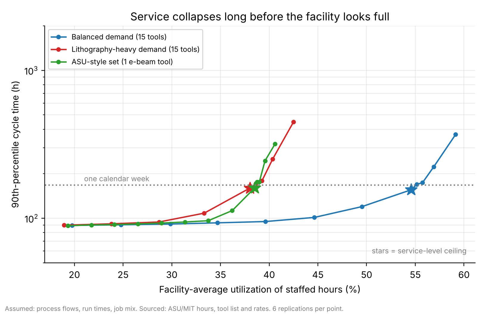

# Shared-use nanofab: economics and queueing

Two linked Python projects on one question: **What does it cost to run a shared-use nanofabrication facility, and how many
tool-hours can it actually sell before waiting times make it unusable?**

| Folder | What it is |
| --- | --- |
| `cost-model/` | Techno-economic Monte Carlo model: 10,000 trials, 15-tool facility, 10 years, after-tax present worth, IRR, tornado sensitivity, break-even pricing, four fee structures. |
| `queueing-sim/` | Discrete-event simulation of the same facility (and an ASU-style 18-station set): staffed-hour calendars, process flows, failures, first-come-first-served, shortest-run-first and reservation rules. Validated against queueing theory, then linked to the cost model's present-worth logic. |

The simulation imports the cost model (`queueing-sim/pw_link.py` runs `cost-model/nanofab_tea_model.py`), so keep both folders side by side.

## Headline results
- The facility does not pay back at academic rates in the cost model; utilization is the dominant uncertainty.
- In the simulation, service collapses at about 55% average utilization (balanced demand) because several tools saturate together; one added unit of almost any tool changes the ceiling by 0 to 1 job/week.
- Reservation blocks and padding cut the usable ceiling by 5 to 41%; adding a tool usually lowers present worth at ASU's $52.50/h tool rate.



## Sources versus assumptions
Sourced from public pages: NIST NanoFab cost-of-ownership paper, MIT.nano and Georgia Tech rate sheets, ASU NanoFab equipment list, rates and hours,
BLS wages, EIA and LBNL energy data, Damodaran cost of capital. Assumed (no facility supplied them): process flows, run times, job mix, handling gaps,
booking grid and padding, and several cost-model inputs (each is labeled with a confidence level in `cost-model/assumptions.csv`).
Treat shapes as robust and exact numbers as illustrative.

## Run it
```bash
pip install -r requirements.txt
cd cost-model && python nanofab_tea_model.py                  # writes CSVs and figures here
cd ../queueing-sim
python validate_des.py                                        # ~1-2 min, checks the engine against queueing theory
python run_baseline.py && python run_asu.py                   # Weeks 1-2 experiments
python run_week3.py && python analyze_week3.py                # Week 3 (about 20 min); week3_raw.pkl is included so
python make_portfolio_figs.py                                 #   the last two steps run without recomputing
```
Details: `cost-model/PROJECT_NOTES.md` and `queueing-sim/README.md`.
